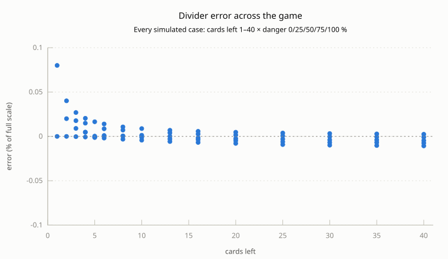
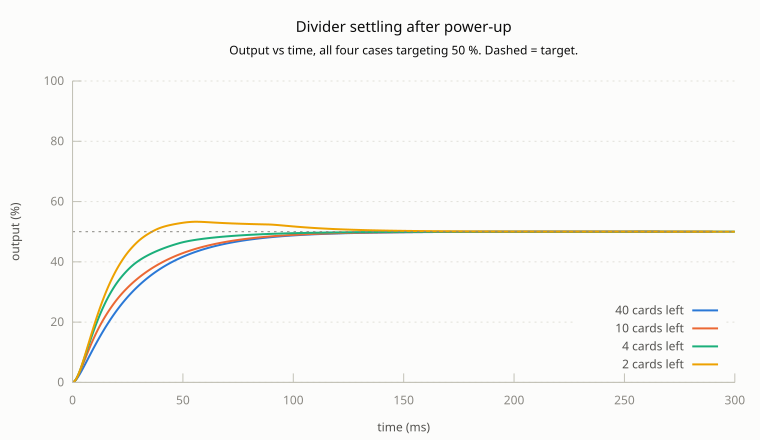
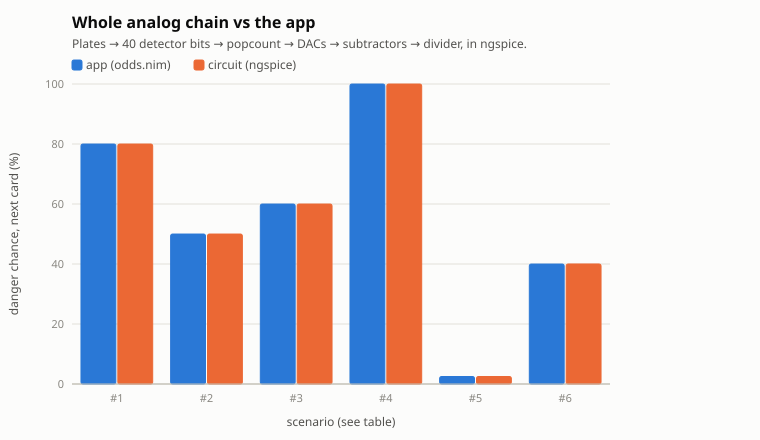
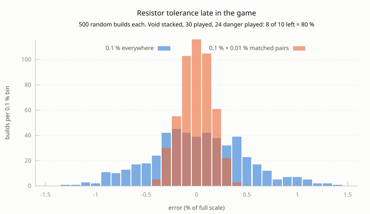

# Simulation results

Generated by `nim results`. Every number below comes from the CSV files beside this
report, and every chart is drawn from those CSVs by gnuplot.

Scale: 0.25 V per card, 10 V = 40 cards = 100 %. Errors are in % of full scale
(10 V), so 2.5 % = one card.

## 1. Divider accuracy



69 cases, cards left 1–40, danger 0–100 %. **Worst error 0.080 % of
full scale** (0.032 of a card). Data: [divider-accuracy.csv](divider-accuracy.csv).

## 2. Divider settling



- 40 cards left: within 0.1 % after 166 ms
- 10 cards left: within 0.1 % after 161 ms
- 4 cards left: within 0.1 % after 141 ms
- 2 cards left: within 0.1 % after 181 ms

The 2-pole output filter dominates. With few cards left the loop itself is slower
(time constant 40 ms ÷ cards left): it starts at full duty, so the output rises
faster and overshoots a little before settling. Either way it's under a fifth of a
second. Data: [divider-settling.csv](divider-settling.csv).

## 3. Whole chain vs the app



| # | Plates stacked | n | d | Lit | App | Circuit |
|---|---|---|---|---|---|---|
| 1 | Void | 0 | 0 | 32 | 80.00 % | 80.00 % |
| 2 | Void + Caves + blank-safe | 10 | 3 | 18 | 50.00 % | 50.00 % |
| 3 | Caves + Rocky + Desert | 20 | 5 | 17 | 60.00 % | 60.00 % |
| 4 | Ruins + blank-safe | 37 | 1 | 26 | 100.00 % | 100.00 % |
| 5 | all 12 | 0 | 0 | 1 | 2.50 % | 2.50 % |
| 6 | Hostile + Crystalline | 30 | 27 | 31 | 40.00 % | 40.00 % |

n = cards played, d = danger cards played, Lit = detector positions lit by the
stack. **Worst disagreement 0.004 % of full scale.** Ideal op-amps;
resistor tolerance is section 4. Data: [chain-vs-app.csv](chain-vs-app.csv).

## 4. Resistor tolerance (Monte Carlo)



Every resistor in M4–M6 is drawn uniformly within its tolerance; op-amps are ideal.
The case is late in the game (10 cards left): the circuit subtracts nearly equal
large voltages there (8 V − 6 V, 10 V − 7.5 V), so a 0.1 % gain error on 8 V becomes
0.4 % of a 2 V difference. Matched 0.01 % networks for the gain-setting pairs (×2
amps, DAC feedback and inverters, difference amps) fix most of it; the 40 counting
resistors and the DAC weights can stay 0.1 %.

| Resistors | SD | Worst of 500 | Worst, in cards |
|---|---|---|---|
| 1 % everywhere | 4.621 % | 12.969 % | 5.19 |
| 0.1 % everywhere | 0.469 % | 1.386 % | 0.55 |
| 0.1 % + 0.01 % matched pairs | 0.157 % | 0.436 % | 0.17 |

1 % parts aren't plotted: their spread is far off this scale. Data:
[resistor-tolerance.csv](resistor-tolerance.csv).

## 5. Unit tests

Including the optics check: every one of the 8190 plate stacks lights exactly the
app's danger cards. Log: [unit-tests.txt](unit-tests.txt).

## Reproduce

```
nim results   # this report (needs ngspice and gnuplot)
nim sim       # whole-chain check only
nim test      # unit tests
```

`hardware/results.nim` runs the simulations and writes the CSVs; `hardware/plots.gp`
draws the charts from them. Netlists and ngspice logs go to `build/sim/`.
